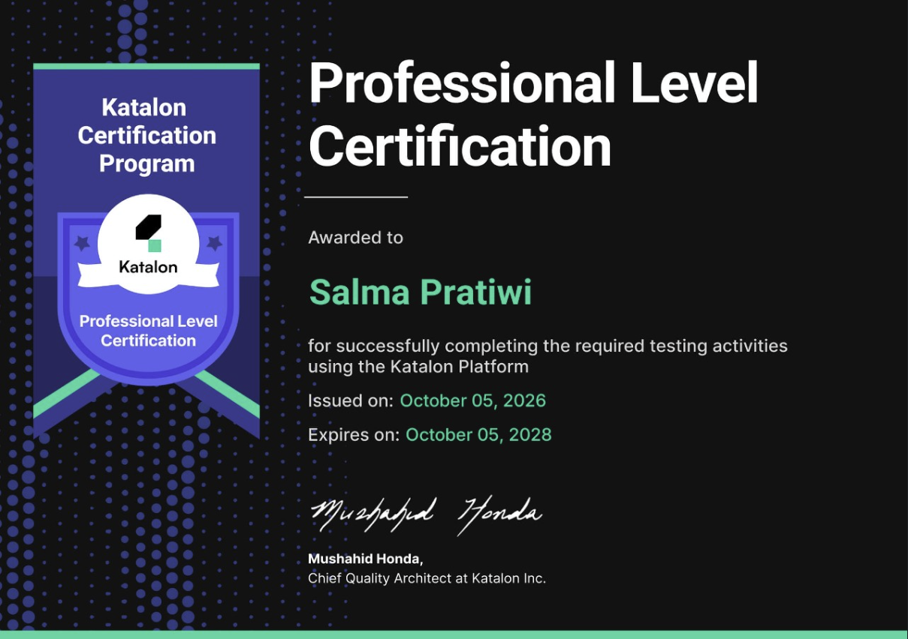
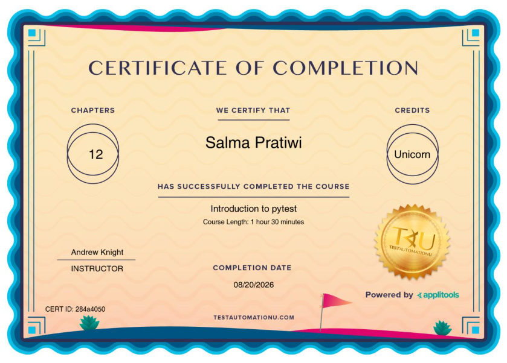
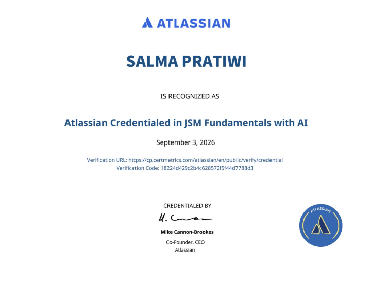
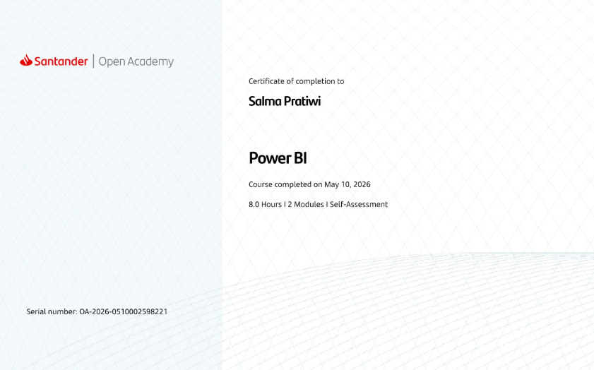
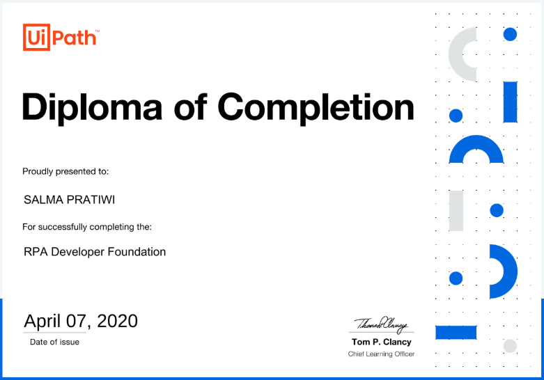
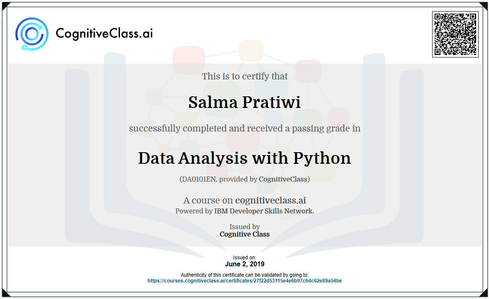
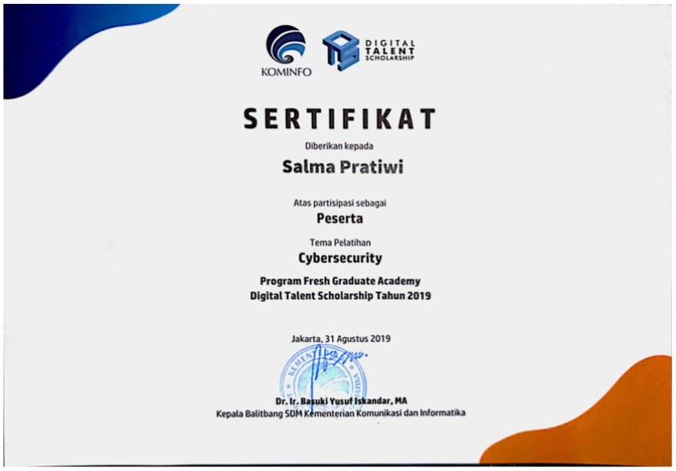

# Certifications

## AWS with Hands-On Labs
Issued by KodeKloud   <small>(November 2026)</small>

???+ info "Show Credential"
    <figure markdown="span">
        { width="700" }
        <figcaption>
        KodeKloud AWS for Beginners with Hands-On Labs Certificate 
        [Credential link](https://learn.kodekloud.com/learn/certificate/2fe472f9-4061-4295-a5e4-abea074249fe)
        </figcaption>
    </figure>

## Kubernetes - Hands-On Tutorial
Issued by KodeKloud   <small>(November 2026)</small>

???+ info "Show Credential"
    <figure markdown="span">
        { width="700" }
        <figcaption>
        KodeKloud Kubernetes for the Absolute Beginners - Hands-On Tutorial Certificate 
        [Credential link](https://learn.kodekloud.com/learn/certificate/4fba7050-b205-471b-9856-e0c690db3d69)
        </figcaption>
    </figure>

## Terraform Basics
Issued by KodeKloud   <small>(October 2026)</small>

???+ info "Show Credential"
    <figure markdown="span">
        { width="700" }
        <figcaption>
        KodeKloud Terraform Basics Training Course Certificate 
        [Credential link](https://learn.kodekloud.com/learn/certificate/a61a07eb-1d0b-4243-a0fa-7161ccceef83)
        </figcaption>
    </figure>

## Ansible Basics
Issued by KodeKloud   <small>(October 2026)</small>

???+ info "Show Credential"
    <figure markdown="span">
        { width="700" }
        <figcaption>
        KodeKloud Ansible Basics - Beginners Course Certificate 
        [Credential link](https://learn.kodekloud.com/learn/certificate/8d9d99b3-dd86-4c74-b897-1e9cdc331443)
        </figcaption>
    </figure>

## Docker Training Course
Issued by KodeKloud   <small>(October 2026)</small>

???+ info "Show Credential"
    <figure markdown="span">
        { width="700" }
        <figcaption>
        KodeKloud Docker Training Course for the Absolute Beginner Certificate 
        [Credential link](https://learn.kodekloud.com/learn/certificate/6a266a1a-95d5-4d98-ab60-dcc94249e72c)
        </figcaption>
    </figure>

## KodeKloud GIT
Issued by KodeKloud   <small>(October 2026)</small>

???+ info "Show Credential"
    <figure markdown="span">
        { width="700" }
        <figcaption>
        KodeKloud GIT for Beginners Certificate 
        [Credential link](https://learn.kodekloud.com/learn/certificate/006614ab-f6ed-4bdd-83ad-c7f0c0acf911)
        </figcaption>
    </figure>

## Shell Script for Beginners
Issued by KodeKloud   <small>(October 2026)</small>

???+ info "Show Credential"
    <figure markdown="span">
        { width="700" }
        <figcaption>
        KodeKloud Shell Script for Beginners Certificate 
        [Credential link](https://learn.kodekloud.com/learn/certificate/195df20b-9b46-4885-b410-1ee984fccf6d)
        </figcaption>
    </figure>

## Linux Basics Course & Labs
Issued by KodeKloud   <small>(October 2026)</small>

???+ info "Show Credential"
    <figure markdown="span">
        { width="700" }
        <figcaption>
        KodeKloud Linux Basics Course & Labs Certificate 
        [Credential link](https://learn.kodekloud.com/learn/certificate/8645a86d-e648-4f41-9aec-d9a9b5290580)
        </figcaption>
    </figure>
    
## Katalon Professional
Issued by Katalon   <small>(October 2026)</small>

???+ info "Show Credential"
    <figure markdown="span">
        { width="700" }
        <figcaption>
        Katalon Professional Level Certificate 
        [Credential link](https://academy.katalon.com/mcertificate/6ac33fc0ddb0c)
        </figcaption>
    </figure>

## Continuous Integration with Jenkins
Issued by Test Automation University   <small>(September 2026)</small>

???+ info "Show Credential"
    <figure markdown="span">
        { width="700" }
        <figcaption>
        Continuous Integration with Jenkins Certificate 
        [Credential link](https://testautomationu.applitools.com/certificate/?id=3922c30d)
        </figcaption>
    </figure>

## Selenium Webdriver with Python
Issued by Test Automation University   <small>(September 2026)</small>

???+ info "Show Credential"
    <figure markdown="span">
        { width="700" }
        <figcaption>
        Selenium Webdriver with Python Certificate 
        [Credential link](https://testautomationu.applitools.com/certificate/?id=4c8dbeb5)
        </figcaption>
    </figure>

## API Test Automation with Postman
Issued by Test Automation University   <small>(September 2026)</small>

???+ info "Show Credential"
    <figure markdown="span">
        { width="700" }
        <figcaption>
        API Test Automation with Postman Certificate 
        [Credential link](https://testautomationu.applitools.com/certificate/?id=530e6dbe)
        </figcaption>
    </figure>

## Introduction to Playwright
Issued by Test Automation University   <small>(August 2026)</small>

???+ info "Show Credential"
    <figure markdown="span">
        { width="700" }
        <figcaption>
        Introduction to Playwright Certificate 
        [Credential link](https://testautomationu.applitools.com/certificate/?id=25573dc8)
        </figcaption>
    </figure>

## Introduction to pytest
Issued by Test Automation University   <small>(August 2026)</small>

???+ info "Show Credential"
    <figure markdown="span">
        { width="700" }
        <figcaption>
        Introduction to pytest Certificate 
        [Credential link](https://testautomationu.applitools.com/certificate/?id=284a4050)
        </figcaption>
    </figure>

## Jira Service Management with AI Fundamentals
Issued by Atlassian   <small>(September 2026 - September 2027)</small>

???+ info "Show Credential"
    <figure markdown="span">
        { width="700" }
        <figcaption>
        Jira Service Management with AI Fundamentals Certificate 
        [Credential link](https://cp.certmetrics.com/atlassian/en/public/verify/credential/18224d429c2b4c628572f5f44d7788d3)
        </figcaption>
    </figure>

## Control-M 20.x for Automation API Developers Online Exam
Issued by BMC Software  <small>(February 2024 - February 2026)</small>

???+ info "Show Credential"
    <figure markdown="span">
        { width="700" }
        <figcaption>
        Control-M Automation API Developer Certificate
        </figcaption>
    </figure>

## Control-M 21.x for Schedulers Online Exam
Issued by BMC Software  <small>(May 2025 - May 2027)</small>

???+ info "Show Credential"
    <figure markdown="span">
        { width="700" }
        <figcaption>
        Control-M Scheduler Certificate
        </figcaption>
    </figure>

## Analyzing and Visualizing Data with Microsoft Power BI
Issued by Santander Open Academy  <small>(May 2026)</small>

???+ info "Show Credential"
    <figure markdown="span">
        { width="700" }
        <figcaption>
        Power BI Certificate
        </figcaption>
    </figure>

## RPA Developer Foundation
Issued by UiPath  <small>(April 2020)</small>

???+ info "Show Credential"
    <figure markdown="span">
        { width="700" }
        <figcaption>
        RPA Developer Foundation Certificate
        </figcaption>
    </figure>

## IBM Certified Specialist - Cognos TM1 10.1 Data Analysis
Issued by Cognitive Class  <small>(June 2019)</small>

???+ info "Show Credential"
    <figure markdown="span">
        { width="700" }
        <figcaption>
        Data Analysis with Python Certificate 
        [Credential link](https://courses.cognitiveclass.ai/certificates/27f22d53115e4e6b97c6dc62e89a54be)
        </figcaption>
    </figure>

## Cybersecurity Digital Talent Scholarship
Issued by Kominfo  <small>(August 2019)</small>

???+ info "Show Credential"
    <figure markdown="span">
        { width="700" }
        <figcaption>
        Cybersecurity Digital Talent Certificate
        </figcaption>
    </figure>
